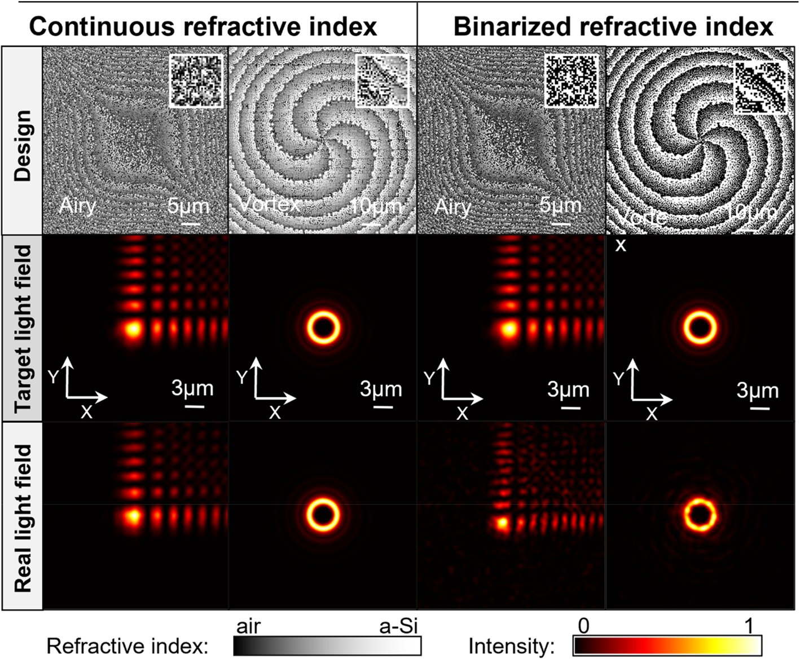
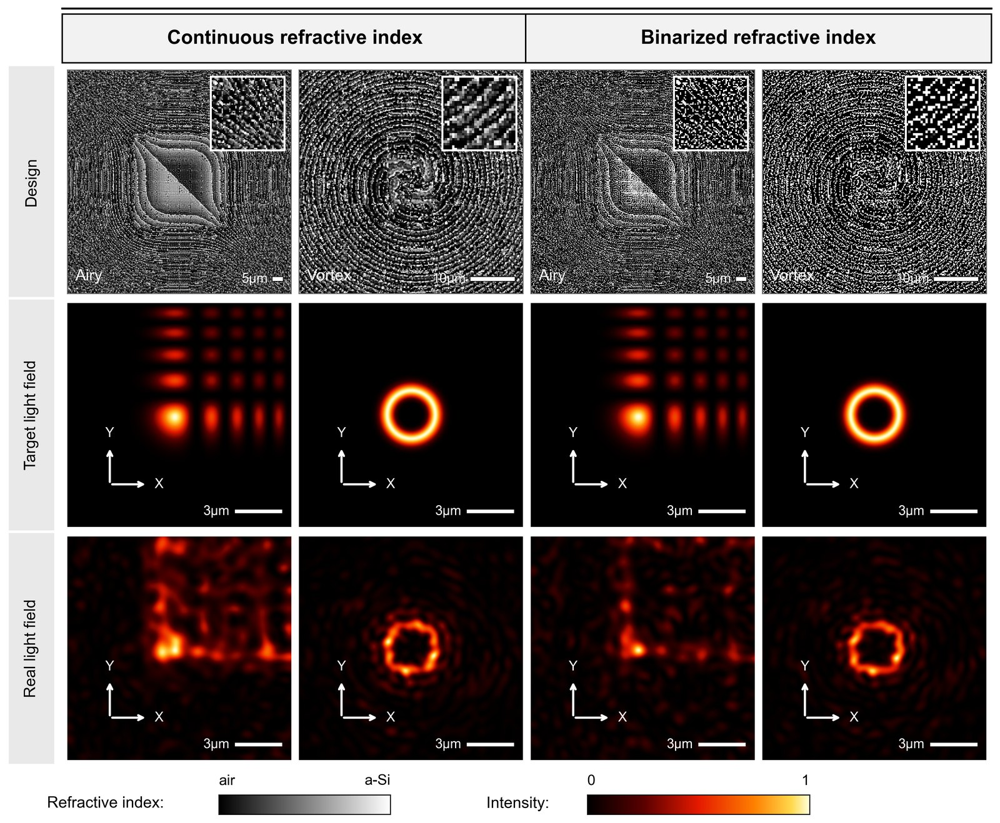

# MetaE-former 复现 · 神经网络驱动的超表面逆向设计

> PhotoniX 2026 论文 *Rapid inverse design of large-scale freeform metaoptics with the neighborhood-attention transformer* 的**纯 CPU 复现**。
> 完整的四件套：源码 / 预训练权重 / 复现结果图 / 零基础教程。

**📄 项目主页（含结果对照与下载）：<https://alice-p197.github.io/metae-former/>**

---

## 这个仓库是什么

把一个"用 Transformer 代理模型做超表面逆向设计"的论文，拆成能在一台没有 GPU 的电脑上跑通的完整链路：

```
自由形状超原子（4 类，流式生成）
      │  split-step BPM 打标签（替代论文的 RCWA/FDTD）
      ▼
预训练 MetaE-former（NAT U-Net，0.82 M 参数）      pretrain.py
      │  用预训练模型反演任务结构 → 存档中间 RI → 重新标注（自监督数据引擎）
      ▼
任务微调（差分学习率 0.5a / 5a / 8a / 10a / 15a）   finetune.py
      ▼
任意任务逆向设计（5 µm patch 反演 + 84% 切割拼接 + 二值化惩罚）
      │                                              design.py
      ▼
焦面光斑 / FWHM / 效率 / x-z 传播验证              evaluate.py
```

## 快速开始

```bash
git clone https://github.com/Alice-P197/metae-former.git
cd metae-former
pip install -r requirements.txt

# 确认权重可用（约 26 秒）
python evaluate.py --ckpt checkpoints/pretrain.pt --n 48

# 涡旋光逆向设计（数分钟，产物在 outputs/vortex6/）
python design.py --task vortex --l 6 --ckpt checkpoints/finetune2.pt --out outputs/vortex6
```

也可以直接打开 GUI：

```bash
python gui_app.py            # 四个标签页：训练 / 逆向设计 / 场可视化验证 / 模型评估
python gui_app.py --selftest # 无头自检，改代码后的回归测试
```

## 复现结果

| 论文 Fig.6 | 本复现 |
|---|---|
|  |  |

**方法链路全部跑通，数值精度没有追平论文。** 差异的根因（模型容量 1/49、BPM 替代 FDTD、小块拼接累积误差）已在[项目主页](https://alice-p197.github.io/metae-former/#results)逐条列出，未做美化。

代理模型精度（`evaluate.py --n 48` 实测）：

| 样本族 | 幅度 MAE | 相位 MAE | 论文区间 |
|---|---|---|---|
| random | 0.123 | 0.171 | 0.037 – 0.114 |
| island | 0.096 | 0.077 | 0.037 – 0.114 |
| stripe | 0.134 | 0.087 | 0.037 – 0.114 |
| **overall** | **0.118** | **0.112** | 0.067 – 0.123（相位） |

## 与论文的差异

| 要素 | 论文 | 本仓库 |
|---|---|---|
| 真值求解器 | RCWA / FDTD 全波 | **split-step BPM 近似**（`metae/solver.py`） |
| 训练数据 | 26 万样本，20 epoch | 流式生成，1600 step ≈ 3.8 万 |
| 网络规模 | 16 块 · embed 256 · 16 heads（≈40 M） | 7 块 · embed 48 · 4 heads（0.82 M） |
| 设计口径 | 1 mm · 57121 patches | 4×4 patches（16.8 µm） |
| 硬件 | GPU 集群 | 纯 CPU |

换真数据只需替换 `metae/solver.py` 的计算核心，保持 `(B,25,25) → (B,2,100,100)` 接口即可，其余代码不用动。

## 目录

```
metae/
  solver.py   近似 Maxwell 求解器（split-step BPM）+ 角谱传播
  data.py     四类自由形状超原子采样器
  model.py    MetaE-former：NAT U-Net（NeighborhoodAttention / NABlock / CPE）
  losses.py   L = L_amp + α·L_phase（论文 Eq.1–3）
  metrics.py  归一化 MAE、幅度/角度 MAE
  tasks.py    目标相位：lens / vortex / airy / custom
  pipeline.py 高层封装，CLI 与 GUI 共用
  utils.py    归一化与 checkpoint 加载
pretrain.py        预训练
finetune.py        自监督数据引擎 + 差分学习率微调
design.py          ★ 主设计入口（论文 Eq.4–7）
direct_design.py   物理直接设计（全口径可微 BPM，不经代理）
design_fig6.py     论文 Fig.6 的批量复现设计
make_fig6.py       Fig.6 出图
refine_display.py  已存结构的高分辨前向验证
evaluate.py        Table 1 风格评估
gui_app.py         PyQt5 图形界面
docs/              GitHub Pages 站点
TUTORIAL.md        零基础教程（约 970 行）
```

## 两条设计路线

| | `design.py`（代理） | `direct_design.py`（直接） |
|---|---|---|
| 优化循环里算光场 | 神经网络（快，误差 ~1 rad） | 真 BPM（准，慢） |
| 口径 | 5 µm patch 反演后拼接 | 全口径一次反演 |
| 耗时 | 2 – 5 分钟 | 数十分钟 |
| 用途 | 日常设计 | 验收 / 归因"是模型不够还是物理设定错" |

## 教程

[TUTORIAL.md](TUTORIAL.md) 写给**完全没接触过深度学习**的读者：从张量、训练循环、代理模型、可微性讲起，
再到 patch 拼接、二值化惩罚、形状账本与排错手册。建议按 `tasks.py → solver.py → data.py → model.py → pretrain.py → design.py` 的顺序读。

## 引用

```bibtex
@article{kuang2026metae,
  title   = {Rapid inverse design of large-scale freeform metaoptics
             with the neighborhood-attention transformer},
  author  = {Kuang, and others},
  journal = {PhotoniX},
  year    = {2026}
}
```

## 声明

本项目是第三方复现，非论文作者官方代码。真值场由 split-step BPM 生成，绝对数值不可与论文对标。
论文图片版权归原作者与期刊所有，此处仅用于学术对照。代码以 MIT 许可发布。
